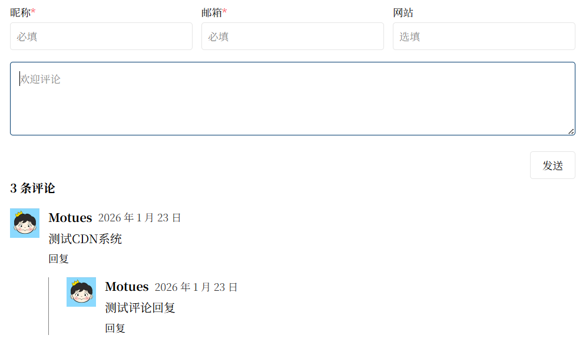

# Momo Comment Frontend

简单、易用的前端评论组件，使用 Svelte 构建，支持多语言与黑暗模式。

## 快速使用

只需要导入一个js文件，就可以在前端使用。

```html
<div id="momo-comment"></div>

<script src="https://cdn.jsdelivr.net/npm/@motues/momo-comment@1.7.x/dist/momo-comment.min.js"></script>
<script>
    momo.init({
        el: '#momo-comment', // 评论容器的 id
        title: 'Test', // 文章标题
        slugId: 'blog/test', // 文章的唯一 slugId
        lang: 'zh-cn', // 语言，目前支持 zh-cn, en
        apiUrl: 'https://api-momo.motues.top' // 后端地址
        });
</script>
```

> 建议使用版本号锁定版本，避免版本更新导致冲突

## ⚠️ 版本与后端的配套要求（1.6.0 起为破坏性变更）

1.6.0 起评论区组件使用**协议 v2** 的人机验证（第一层为 HashWX 工作量证明，第二层为 Instrumentation 环境质询），必须与同时升级的后端配套。注意**包版本与协议版本是两件事**：包版本是 1.6.0，协议版本号是 `v2`。

| 前端版本 | 需要搭配的后端 |
|---|---|
| 1.5.0 及更早 | v1 后端（旧版 SHA-256 无感验证） |
| 1.6.0 – 1.6.x | v2 后端（HashWX + Instrumentation 环境质询） |
| 1.7.0 – 1.7.x | v2 后端 + 表情配置契约 v2（`emoji_enabled` / `emoji_cdn_url`） |
| 1.8.0 及以后 | v2 后端 + 表情配置契约 v3（`emoji_cdn_urls` 多来源，回落 `emoji_cdn_url`）+ 链接安全审查（`urlDormant` / `admin_email_hashes`） |

## 第三方组件

本包的验证功能内联了第三方的 HashWX WebAssembly 模块，它以 **LGPL-3.0** 分发，
与本项目自身的 MIT 许可证不同。许可证全文与构件来源见
[`vendor/hashwx/README.md`](./vendor/hashwx/README.md) 与 [`THIRD_PARTY_NOTICES.md`](./THIRD_PARTY_NOTICES.md)。

## 自定义样式

目前可以修改评论组件的颜色，后续会推出自定义样式的功能。颜色通过设置全局变量来修改，并且支持黑暗模式：
在 `html` / `body` 上挂 `[data-theme="dark"]` 即可，组件自带一套深色默认值（白字、深色边框、亮色链接），
下面这些 `--momo-*` 变量只是覆盖默认值。

```css
:root {
    --momo-text-color: #d51111;            /* 文字颜色 */
    --momo-button-border-color: #e5e5e5;   /* 按钮边框颜色 */
    --momo-button-hover-bg-color: #f5f5f5; /* 按钮背景颜色（hover 状态）*/
    --momo-link-color: #003b6e;            /* 链接颜色 */
    /* 无感验证「验证成功」的绿色（文字 / 边框），可选 */
    --momo-verify-success-color: #15803d;
    --momo-verify-success-border-color: rgba(22, 163, 74, 0.5);
}
/* 暗色模式 */
[data-theme="dark"] { 
    --momo-text-color: #3ad8d8;
    --momo-button-border-color: #2e2e2e;
    --momo-button-hover-bg-color: #3c3c3c;
    --momo-link-color: #fff;
    --momo-verify-success-color: #4ade80;
    --momo-verify-success-border-color: rgba(74, 222, 128, 0.45);
}
```

> **无感验证的绿色跟随主题**：默认浅色用深绿、深色用亮绿，两者都通过 `--momo-verify-success-color` /
> `--momo-verify-success-border-color` 覆盖。没有挂 `data-theme` 的页面会跟随系统的
> `prefers-color-scheme`；如果站点本身只有浅色、而访客系统是深色，请显式挂 `data-theme="light"`
> 锁定浅色，否则会用到深色主题的亮绿。

## 表情

评论输入框下方**左侧**的表情按钮会打开浮动面板，顶部标签栏来自后端配置的那一份 owo.json
（OwO 格式，格式与短代码规则见 [doc/emoji.md](../doc/emoji.md)）：

- **面板挂在 `document.body` 上、用 `position: fixed` 定位**：二级评论（和移动端拍平后的回复）外面套着
  `overflow-hidden` 的容器，`absolute` 面板会被直接裁掉 —— 调高 `z-index` 没用，它只在最近的层叠上下文里比较，
  裁剪切盒照裁。挂到 body 之后才真正盖在最上层；面板配色变量（定义在 `.comment-container` 而不是 `:root`）
  会在打开时从按钮的计算样式复制到面板内联样式，深色模式照常跟随。
- **默认开在按钮下方**（不挡输入框），高度按「按钮底边 → 可视视口底边」的剩余空间自适应（96–256px，
  表情区纵向滚动）；只有下方连 96px 都放不下、且上方更宽裕时才临时翻到按钮上方
  （移动端软键盘弹起时的兜底）。窗口 resize / 页面滚动 / `visualViewport` 变化（键盘、缩放）时重算。
- 面板宽度为 `min(24rem, 可视宽 - 24px)`，由脚本夹住左右边缘：窄屏或按钮本身有缩进（回复框的头像缩进）
  时也不会从右边溢出被裁；**切换标签不会改变宽度**。
- 移动端（≤767px）选中一个表情后面板自动收起，把屏幕还给输入区；桌面端保持打开，可连续选。
- **颜文字按内容宽度自适应**（换行排布），长短不一的颜文字不会被固定列宽的网格挤在一起；
  图片类表情尺寸一致，用 2rem 等宽网格（列数随面板宽度 auto-fill，窄屏自动减列）。
- 面板与标签栏都不做横向滚动（标签栏宽度不足时换行，超长颜文字在自身按钮内换行）。
- **首屏表情加载**：先用 `localStorage` 里 7 天内的 owo.json 缓存**同步水合**（命中缓存时零请求）；
  缓存不存在/已过期且正文里确实有 `:name:` 短代码时，会在首屏渲染后的空闲时段**自动预取一次**
  owo.json，到达后把 `:name:` 升级成表情 —— **不需要先打开表情面板**。
  页面里没有短代码时依旧不发任何第三方请求；预取与面板共用缓存/并发去重，不会重复请求。
- **缓存会自己更新（stale-while-revalidate）**：7 天是可用期，另有一个 **6 小时**的校验间隔。
  到点后打开页面（正文有短代码）或打开表情面板时，会**静默**再拉一次来源：
  内容变了才替换界面（已显示的旧图也会跟着换地址），没变/请求失败都保留缓存，用户不会看到闪动或错误。
  面板头部还有一个常驻的**「刷新表情」按钮**，可以随时强制拉取最新内容（绕过本地与浏览器缓存）。
  源站没有 ETag/Last-Modified，所以校验是整份重下（默认源约 40 KB），间隔不宜更短。
- 拉取失败会回退旧缓存，并在面板内给出「重试」提示；后台预取/校验失败则静默保留文字或旧表情，
  打开面板时会重试。手动刷新失败时保留已有表情，并提示「表情来自本地缓存，点击重试」。

- 表情小图与文字**垂直居中**（行高 1.625em、表情 1.25em）；宿主如需微调可覆盖 `--momo-emoji-align`
  （例如 `--momo-emoji-align: middle;`）。
- 站点可以在后台「系统设置 → 表情设置」里**关闭表情**（`emoji_enabled=false`，此时组件不渲染表情按钮），
  或把来源换成任意 OwO 格式地址（例如 `https://open.motues.top/emoji/owo.json?group=Emoji` 只保留 Emoji 标签）。
- 图片类表情插入的是 `:name:` 短代码，由组件在渲染时替换成内联小图：
  `<code>` / `<pre>` 内不替换，未命中的短代码原样保留为文本（表情源换掉后老评论会优雅降级）。
  跨包重名时（默认源里 `Bilibili` 与 `QQ` 有 33 个同名表情）靠前的包先占名、后来的包追加 `-2`，
  因此**从 QQ 选的动图在评论里仍是那张动图**，不会被 Bilibili 的同名静图顶掉。
- 表情项与未选中的标签都有 hover 高亮（面板底色恰好等于 `--button-hover-bg-color`，
  所以高亮用的是文字色的半透明叠加，而不是复用 hover 底色）。
- 面板底色默认跟随按钮 hover 底色，宿主可用 `--momo-panel-bg` 覆盖：

```css
:root {
    --momo-panel-bg: #ffffff; /* 表情面板底色（暗色模式下可另设） */
}
```

## 本地编译

你也可以下载源码，本地编译出js文件，导入到自己的网站中：

#### 1. 克隆项目，安装依赖

克隆仓库代码

```bash
git clone https://github.com/Motues/Momo-Backend.git
cd Momo-Backend/frontend
pnpm install
```

#### 2. 编译

编译后的文件在 dist 目录下，文件名为 `momo-comment.min.js`。

```bash
pnpm build
```

## 样式效果

